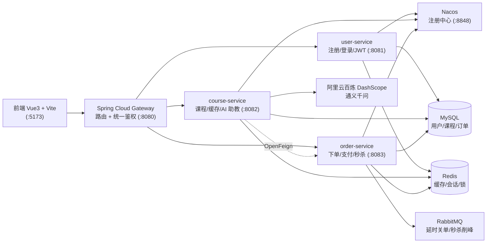

# 博学优课 · 在线课程交易与学习平台

[](https://spring.io/projects/spring-boot)
[](https://spring.io/projects/spring-cloud)
[](https://github.com/alibaba/spring-cloud-alibaba)
[](https://vuejs.org/)
[](LICENSE)

基于 **Spring Cloud Alibaba 微服务架构**的在线课程交易与学习平台，覆盖「用户认证 → 课程商城 → 下单支付(模拟) → 超时自动关单 → 秒杀 → AI 学习助教」全链路。

## ✨ 项目特性

- 🏗️ **微服务架构**：Spring Cloud Gateway 网关统一鉴权 + 用户/课程/订单三个业务服务 + Nacos 注册发现 + OpenFeign 服务调用
- ⚡ **高并发秒杀**：Redis Lua 原子预扣库存 + RabbitMQ 削峰异步落库，配套幂等、库存回补、死信兜底
- ⏰ **可靠延时任务**：RabbitMQ TTL + 死信队列实现订单超时自动关单，生产者确认 + 手动 ACK + 本地重试 + 真死信
- 🔐 **分布式锁演进**：手写 SETNX + Lua 原理版 → Redisson 生产版（可重入 + 看门狗续期）
- 🤖 **AI 学习助教**：Spring AI + 阿里云通义千问，支持多轮记忆（Redis）、工具调用（查真实课程/已购课程）、RAG 检索增强

## 🏗️ 系统架构



## 📦 模块组织

```
.
├── backend/                        # 后端 Maven 多模块工程（Java 17）
│   ├── boxue-common/               # 公共库：JWT 工具 / 统一返回 / 全局异常 / 分布式锁
│   ├── boxue-user-service/         # 用户服务 :8081（注册 / 登录 / JWT / Redis 会话白名单）
│   ├── boxue-course-service/       # 课程服务 :8082（课程 / Redis 缓存 / AI 助教 / RAG）
│   ├── boxue-order-service/        # 订单服务 :8083（下单 / 支付 / 延时关单 / 秒杀）
│   └── boxue-gateway/              # 网关 :8080（路由转发 / JWT 统一鉴权）
├── frontend/                       # 前端 Vue3 + Vite（:5173，Vite 代理到网关）
├── docker/                         # MySQL 建表 + 演示数据脚本
└── docker-compose.yml              # 基础设施一键启动（MySQL/Redis/RabbitMQ/Nacos）
```

## 🛠️ 技术选型

### 后端

| 分类 | 技术 | 版本 | 用途 |
| --- | --- | --- | --- |
| 基础框架 | Spring Boot | 3.5.10 | 应用框架 |
| 微服务 | Spring Cloud | 2025.0.0 | 微服务组件版本管理 |
| 微服务 | Spring Cloud Alibaba | 2025.0.0.0 | Nacos 等阿里组件 |
| 注册中心 | Nacos | 2.3.2 | 服务注册与发现 |
| 网关 | Spring Cloud Gateway | 2025.0.0 | 路由转发 + 统一鉴权 |
| 服务调用 | OpenFeign | 2025.0.0 | 服务间远程调用 |
| ORM | MyBatis-Plus | 3.5.17 | 数据访问 |
| 认证 | JJWT | 0.12.5 | JWT 生成与解析 |
| 缓存/会话 | Redis | 7.x | 缓存 / 会话白名单 / 分布式锁 |
| 消息队列 | RabbitMQ | 3.12 | 延时关单 / 秒杀削峰 / 死信 |
| 数据库 | MySQL | 8.0 | 业务数据存储 |
| AI | Spring AI | 1.1.2 | ChatClient / 工具调用 / 向量检索抽象 |
| AI | 阿里云百炼 DashScope | - | 通义千问（qwen-turbo）/ text-embedding-v3 |

### 前端

| 技术 | 版本 | 用途 |
| --- | --- | --- |
| Vue 3 | 3.5 | 组合式 API + `<script setup>` |
| Vite | 8.x | 构建工具 |
| Vue Router | 4.6 | 路由 + 登录守卫 |
| Axios | 1.20 | HTTP 请求封装 |

## 🔥 核心技术实现

### 1. 分布式锁：自研原理版 → Redisson 生产版
- 手写 `SETNX + Lua`：加锁、防误删（value 校验）、过期防死锁，一个 Lua 脚本保证原子性
- 生产引入 **Redisson**：可重入 + 看门狗自动续期，用于下单防重
- 亮点：既能手写原理，又懂生产选型

### 2. 秒杀：Redis Lua 预扣库存 + MQ 削峰落库
- Redis Lua 脚本**原子**扣减库存（预扣），从机制上杜绝超卖
- 扣减成功 → 发 MQ 异步落库建单（削峰）；发送失败自动回补库存
- 落库幂等（`UPDATE ... WHERE status=0` 原子更新），消费失败进业务死信队列

### 3. 订单延时关单：TTL + 死信队列
- 下单 → 发延迟消息（队列 TTL 15 秒）→ 到期经死信交换机转关单队列
- 消费端幂等原子更新，重复消息无害
- MQ 可靠性四板斧：生产者确认（correlated）、消息持久化、手动 ACK + 本地重试（1s→2s 退避）、重试耗尽显式 Nack 进真死信

### 4. 课程缓存：Cache Aside
- 课程查询走 Redis 缓存（Cache Aside），命中即返回、未命中查库回填
- 学习对话用 Redis List 存储，跨请求保持多轮上下文

### 5. AI 学习助教：Spring AI + 通义千问
- **多轮记忆**：每次提问回放 Redis 历史并发给模型，一问一答落库
- **工具调用**：`@Tool` 声明 `query_courses`（查真实课程）、`list_my_courses`（OpenFeign 跨服务查已购课程），模型按需调用、结果回传再组织回答
- **RAG 检索增强**：课程资料启动时用 `text-embedding-v3` 向量化入 SimpleVectorStore，提问前语义检索 topK=3 拼进系统提示词
- 面向 Spring AI 抽象（ChatClient / EmbeddingModel / VectorStore）编程，换模型供应商业务代码零改动

## 🚀 快速开始

### 环境要求

| 依赖 | 版本 |
| --- | --- |
| JDK | 17 |
| Maven | 3.8+ |
| Node.js | 18+ |
| Docker | 20.10+（含 Docker Compose） |

### 1. 启动基础设施

```bash
docker compose up -d
# MySQL(3307) / Redis(6379) / RabbitMQ(5672, 控制台 15672) / Nacos(8848)
```

### 2. 启动后端（四个进程）

```bash
cd backend
mvn spring-boot:run -pl boxue-gateway         # 网关 :8080
mvn spring-boot:run -pl boxue-user-service    # 用户 :8081
mvn spring-boot:run -pl boxue-course-service  # 课程 :8082（AI 功能需 DASHSCOPE_API_KEY）
mvn spring-boot:run -pl boxue-order-service   # 订单 :8083
```

### 3. 启动前端

```bash
cd frontend
npm install
npm run dev   # http://localhost:5173
```

> 💡 端口说明：本机 3306 被占用，MySQL 映射到 3307；AI 对话需要 `DASHSCOPE_API_KEY`（阿里云百炼），模型为 qwen-turbo。

## 📈 监控与可观测（1-5）

- 每个服务通过 **Spring Boot Actuator** 暴露指标端点 `/actuator/prometheus`（JVM 内存/GC/线程、HTTP 请求耗时等）
- **Prometheus** 每 15 秒抓取四个服务的指标并存储：[http://localhost:9090](http://localhost:9090)
- **Grafana** 连接 Prometheus 展示 JVM 面板：[http://localhost:3001](http://localhost:3001)（admin/admin，导入面板 ID 4701，数据源由 provisioning 自动创建）

```bash
# 启动监控栈（必须与主 compose 合并启动）
docker compose -f docker-compose.yml -f docker-compose.monitor.yml up -d prometheus grafana
```
## 📡 接口一览（统一经网关 :8080）

| 服务 | 方法 | 路径 | 说明 | 鉴权 |
| --- | --- | --- | --- | --- |
| 网关 | GET | /api/health | 健康检查 | 否 |
| 用户 | POST | /api/users/register | 注册（BCrypt 加密） | 否 |
| 用户 | POST | /api/users/login | 登录，返回 JWT，会话写 Redis | 否 |
| 用户 | GET | /api/users/me | 当前用户信息 | 是 |
| 用户 | POST | /api/users/logout | 退出，删除 Redis 会话 | 是 |
| 课程 | GET | /api/courses | 课程列表（Redis 缓存） | 否 |
| 课程 | GET | /api/courses/{id} | 课程详情（Redis 缓存） | 否 |
| 订单 | POST | /api/orders | 下单（Redisson 防重） | 是 |
| 订单 | POST | /api/orders/{id}/pay | 模拟支付 | 是 |
| 订单 | GET | /api/orders/mine | 我的已购课程 | 是 |
| 秒杀 | POST | /api/seckill/{courseId} | Lua 预扣 + MQ 削峰 | 是 |
| AI | POST | /api/learn/ai/chat | AI 助教对话（记忆/工具/RAG） | 是 |
| AI | GET | /api/learn/chat | 学习对话历史 | 是 |

## 🗺️ 后续规划

- JMeter 秒杀/缓存压测报告（1-6）
- Spring AI Alibaba 深度集成：DashScope 原生 / Rerank / Graph 工作流 / MCP（2-x）
- RBAC 权限模型 / GitHub Actions CI（3-x）

## 📄 License

[MIT](LICENSE) © 2026 DONG